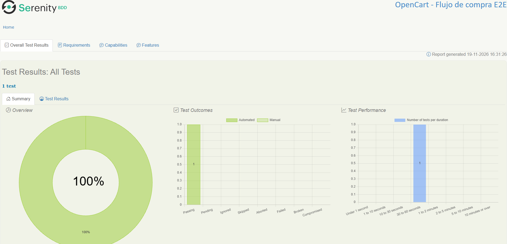
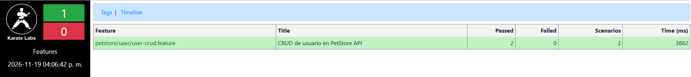
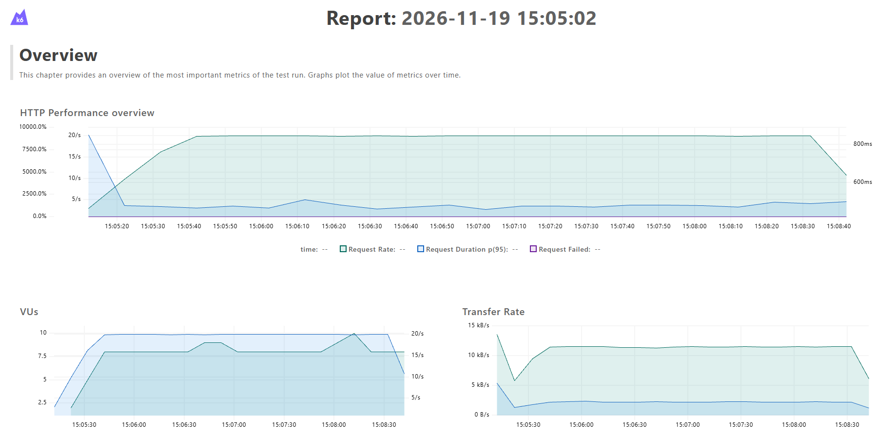

# Reto Técnico – QA Automation (Funcional + Performance)

**Autor:** Santiago Sánchez · QA Manual & Automation Engineer
**Fecha:** noviembre 2026

Solución al reto técnico de automatización: pruebas E2E de UI, pruebas de API REST, prueba de carga y análisis de resultados de performance. Cada carpeta es un proyecto independiente, con su propio `readme.txt` (cómo ejecutarlo, con versiones) y `conclusiones.txt` (hallazgos y conclusiones).

---

## Índice

| Carpeta | Ejercicio | Herramienta | Resultado |
|---|---|---|---|
| [`01-e2e-opencart-serenity`](01-e2e-opencart-serenity) | Prueba Técnica V9 – Ejercicio 1: compra E2E en OpenCart con Guest Checkout | Serenity BDD 5.3.8 + Screenplay + Cucumber | ✅ 1/1 escenarios |
| [`02-api-petstore-karate`](02-api-petstore-karate) | Prueba Técnica V9 – Ejercicio 2: CRUD de usuario en PetStore API | Karate 1.5.2 | ✅ 2/2 escenarios |
| [`03-performance-k6-login`](03-performance-k6-login) | Performance – Ejercicio 1: prueba de carga del login (20 TPS) | k6 v2.4.0 | ✅ Cumple SLA |
| [`04-performance-analisis`](04-performance-analisis) | Performance – Ejercicio 2: análisis de resultados de una prueba de carga | Informe en Word | ❌ No cumple SLA (ver informe) |

---

## 01 · E2E de compra en OpenCart (Serenity BDD)

Flujo automatizado en http://opencart.abstracta.us/: agregar **MacBook** e **iPhone** al carrito → ver el carrito → **Guest Checkout** → confirmación *"Your order has been placed!"*.

- **Patrón Screenplay:** un actor (el cliente) realiza tareas de negocio y responde preguntas sobre la pantalla. Los selectores están separados en clases de UI.
- **Escenario en Gherkin en español**, con los datos de productos y del cliente en tablas.
- **Esperas explícitas** sobre elementos únicos de cada estado (el checkout carga por AJAX), sin pausas fijas.

📄 [readme.txt](01-e2e-opencart-serenity/readme.txt) · [conclusiones.txt](01-e2e-opencart-serenity/conclusiones.txt) · [Reporte HTML](ghttps://santisanchez4.github.io/qa-challenge-sofka/01-e2e-opencart-serenity/reports/index.html)

---

## 02 · CRUD de usuario en PetStore API (Karate)

Casos: **crear** usuario → **buscar** → **actualizar** nombre y correo → **buscar** actualizado → **eliminar**. Además, se verifica que el usuario eliminado ya no existe y se prueba un escenario negativo (usuario inexistente → 404).

- Datos únicos por ejecución (timestamp), porque es una API pública compartida.
- Validación del objeto completo en cada respuesta (`match ==`), no solo del código de estado.
- Hallazgo destacado: la API **devuelve la contraseña en texto plano** y no requiere autenticación.

📄 [readme.txt](02-api-petstore-karate/readme.txt) · [conclusiones.txt](02-api-petstore-karate/conclusiones.txt) · [Reporte HTML](https://santisanchez4.github.io/qa-challenge-sofka/02-api-petstore-karate/reports/karate-summary.html)

---

## 03 · Prueba de carga del login (k6)

Servicio `POST https://fakestoreapi.com/auth/login`, con usuarios parametrizados desde CSV. Criterios: **≥ 20 TPS**, respuesta **≤ 1,5 s** y error **< 3%**.

Se ejecutaron 3 corridas de línea base (2 TPS), 3 de carga (20 TPS) y 1 de estrés exploratorio (hasta 40 TPS), con un modelo abierto (`ramping-arrival-rate`) para garantizar las TPS.

| Métrica (promedio de 3 corridas) | Objetivo | Baseline 2 TPS | Carga 20 TPS | Estrés hasta 40 TPS |
|---|---|---|---|---|
| p95 | ≤ 1,5 s | 512 ms | **486 ms** | 480 ms |
| Tasa de error | < 3% | 0% | **0%** | 0% |
| TPS sostenidas | ≥ 20 | 2 | **20** | 40 |

**Conclusión:** cumple los 3 criterios con amplio margen y no se degrada hasta 2 veces la carga objetivo.

📄 [readme.txt](03-performance-k6-login/readme.txt) · [conclusiones.txt](03-performance-k6-login/conclusiones.txt) · [Reporte HTML (carga)](https://santisanchez4.github.io/qa-challenge-sofka/03-performance-k6-login/reports/load/load-run1.html)

---

## 04 · Análisis de resultados de performance

Análisis del `textSummary.txt` y del gráfico VUs vs peticiones por segundo de una prueba de 63 minutos con 140 VUs.

- **Veredicto: no cumple.** El p95 es de 1,57 s (límite 1,5 s), aunque el threshold del script se marcó como aprobado.
- **Incidente de ~8 minutos:** con la carga constante, las peticiones por segundo cayeron de ~80 a ~12. Ahí se concentran el 99,96% de los errores, mayormente HTTP 5xx.
- Recomendaciones priorizadas para encontrar la causa raíz.

📄 [InformeResultados.docx](04-performance-analisis/InformeResultados.docx) (formato Word actual, compatible con .doc)

---

## Requisitos generales

| Herramienta | Versión usada | Necesaria para |
|---|---|---|
| Java JDK | 17+ (probado con Temurin 25) | 01, 02 |
| Apache Maven | 3.9+ (probado con 3.10.1) | 01, 02 |
| Google Chrome | estable actual | 01 |
| k6 | v2.4.0 | 03 |

Las instrucciones paso a paso están en el `readme.txt` de cada carpeta.

## Cómo ver los reportes

- **En línea:** los links "Reporte HTML" de cada sección (GitHub Pages).
- **Sin conexión:** descargar el repo (**Code → Download ZIP**) y abrir el archivo `.html` de la carpeta `reports/` de cada ejercicio con el navegador.

## Uso de IA

Usé Claude (Anthropic) como asistente durante el reto, fuera del repositorio: no se incluye ningún toolkit ni integración de IA porque el ejercicio no lo requería.

**En qué me apoyé:** estructura de los proyectos, generación del código base, borradores de documentación, revisión y análisis de datos y gráficos de performance.

**Lo que hice yo:** ejecuté todas las pruebas en mi equipo (Windows 11), depuré los errores que aparecieron, validé cada número contra los reportes y tomé las decisiones finales sobre el enfoque y los criterios.

**Criterio de uso:** la IA no reemplaza la verificación. Cada resultado se contrastó contra la evidencia real (reportes, métricas, capturas). En un proyecto real, la uso solo con información no sensible: nunca con credenciales, datos de clientes ni código o configuración confidencial de la empresa, y siempre sobre ambientes controlados (QA), nunca sobre producción.
